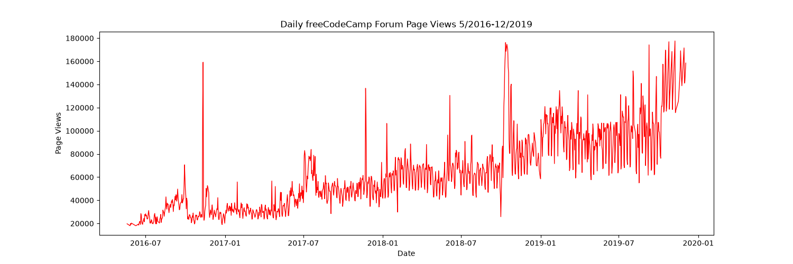
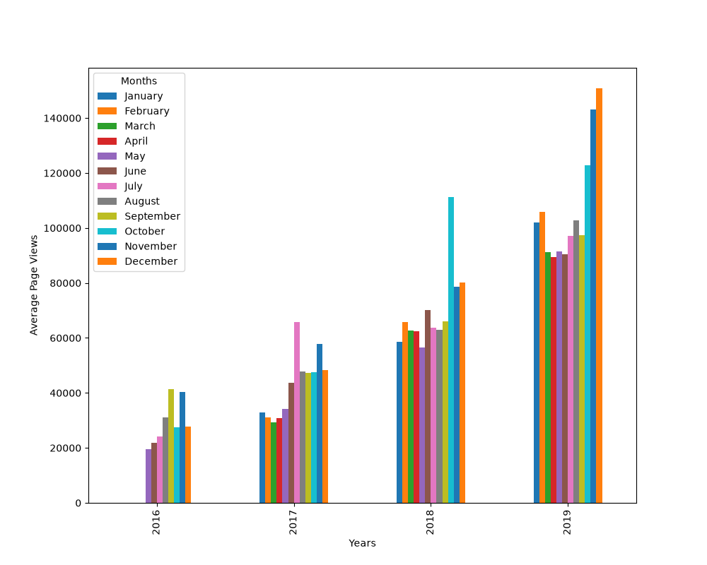
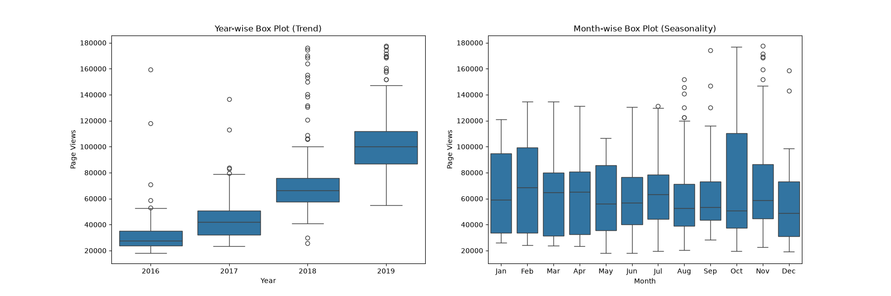

# Page View Time Series Visualizer

A Python, Pandas, Matplotlib and Seaborn project by **Junot Cacoq** for the freeCodeCamp Data Analysis with Python curriculum.

It analyzes the daily page views of the freeCodeCamp forum (May 2016 to December 2019) and draws three charts: a line plot, a bar plot and two box plots.

## Dataset

`fcc-forum-pageviews.csv` has two columns, `date` and `value`, with 1,304 daily records. The data is cleaned by removing the days in the top 2.5% and bottom 2.5% of page views, which leaves **1,238 days**.

## Charts

Every chart is saved in the project folder when its function runs, wherever you start Python from.

| File | Created by | Shows |
| --- | --- | --- |
| `line_plot.png` | `draw_line_plot()` | Daily page views over time. |
| `bar_plot.png` | `draw_bar_plot()` | Average daily page views for each month, grouped by year. |
| `box_plot.png` | `draw_box_plot()` | Year-wise box plot (trend) and month-wise box plot (seasonality). |







## Project files

| File | Purpose |
| --- | --- |
| `time_series_visualizer.py` | Loads and cleans the data, draws and saves the three charts. |
| `fcc-forum-pageviews.csv` | Input dataset. |
| `main.py` | Draws the charts and runs the tests. |
| `test_module.py` | Unit tests for the data cleaning, the three charts and the saved image files. |
| `requirements.txt` | Python dependencies. |

## Installation

```bash
git clone https://github.com/junot10-cpu/fcc-page-view-time-series-visualizer.git
cd fcc-page-view-time-series-visualizer
python3 -m pip install -r requirements.txt
```

## Run the project

```bash
python3 main.py
```

This creates `line_plot.png`, `bar_plot.png` and `box_plot.png` in the project folder and runs the 12 tests.

## Testing

The tests are based on the freeCodeCamp project tests. One data-cleaning check was adjusted to `df['value'].count()` so it also works with recent Pandas versions, and one test was added to confirm the images are saved in the project folder.

## References

- [freeCodeCamp project instructions](https://www.freecodecamp.org/learn/data-analysis-with-python/data-analysis-with-python-projects/page-view-time-series-visualizer)
- [freeCodeCamp starter template](https://github.com/freeCodeCamp/boilerplate-page-view-time-series-visualizer)

## Author

**Junot Cacoq** · [GitHub](https://github.com/junot10-cpu)
